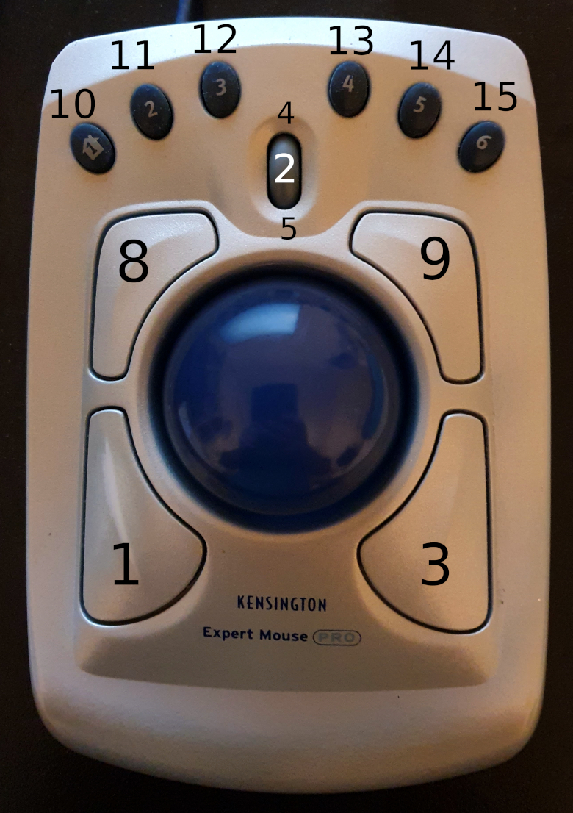

# Kensington Expert Mouse Pro on Linux

Configuration and setup guides for the USB Kensington Expert Mouse Pro on
X11 and Wayland.



The default project layout provides:

- primary, middle, and secondary click;
- back and forward buttons where those buttons are not used as the scroll
  modifier;
- hold a button and roll the ball for two-axis scrolling;
- a documented path to map the six blue buttons to F19–F24; and
- right- and left-handed layouts.

The tested device ID is `047d:1002`. Other hardware revisions may use a
different ID or button codes, so inspect your device before applying a mapping.

## Choose your session

Check the current session:

```sh
printf '%s\n' "${XDG_SESSION_TYPE:-unknown}"
```

Then follow the matching guide:

- **X11:** use the [Xorg setup](#x11-setup).
- **Wayland:** follow [`docs/wayland.md`](docs/wayland.md) for GNOME, Hyprland,
  KDE Plasma, Sway, or niri.
- **Nix/Home Manager:** use the declarative [`docs/nix.md`](docs/nix.md) setup.

An Xorg file does not configure a Wayland compositor. Likewise, `xinput`,
`xmodmap`, `xbindkeys`, and `xte` cannot provide reliable mappings to native
Wayland applications.

## Inspect the device

The helper reports the matching USB and libinput devices:

```sh
./scripts/inspect-device
```

To identify each physical button, run:

```sh
sudo libinput debug-events --show-keycodes
```

See [`docs/button-layout.md`](docs/button-layout.md) for the expected layout.

## X11 setup

Install the Xorg libinput driver, then run the installer:

```sh
./scripts/install-x11
```

It installs the right-handed configuration by default. Available modes include:

```sh
./scripts/install-x11 --left-handed
./scripts/install-x11 --match-usb-id
./scripts/install-x11 --match-usb-id 047d:1002 --left-handed
./scripts/install-x11 --dry-run
```

The script validates its arguments, creates the Xorg configuration directory,
and backs up a different existing destination before replacing it. View all
options with `./scripts/install-x11 --help`.

To install manually instead, copy the configuration:

```sh
sudo install -Dm644 x11/kensington-trackball.conf \
  /etc/X11/xorg.conf.d/90-kensington-trackball.conf
```

Log out of the graphical session and log back in. If the rule does not match,
find the exact product name with:

```sh
xinput list
```

Edit `MatchProduct` in the installed file, or replace it with the USB ID:

```conf
MatchUSBID "047d:1002"
```

The root-level `kensington-trackball.conf` remains as a compatibility copy for
links from older versions of this project. The maintained copy is under `x11/`.

### Left-handed X11 layout

The installer accepts `--left-handed`. For a manual installation, replace the
two corresponding options with:

```conf
Option "ScrollButton" "1"
Option "ButtonMapping" "3 2 8 4 5 6 7 9 1 10 11 12 13 14 15"
```

### Extra buttons on X11

The historical `xmodmap`/`xbindkeys` recipe is intentionally no longer the
primary recommendation. A uinput-based input-remapper preset works across X11
and Wayland and avoids maintaining two unrelated mappings. Follow
[`docs/remapping.md`](docs/remapping.md).

## Troubleshooting

See [`docs/troubleshooting.md`](docs/troubleshooting.md). When reporting a
problem, include the desktop/compositor and version, distribution, USB ID,
and the relevant `libinput` device and button events.

## Contributing

Reports from additional distributions, compositors, and hardware revisions are
welcome. Do not commit captured keyboard input or other unrelated events.

Run the local checks before submitting a change:

```sh
./scripts/check-docs
shellcheck scripts/*
```

This project is available under the [MIT License](LICENSE).
